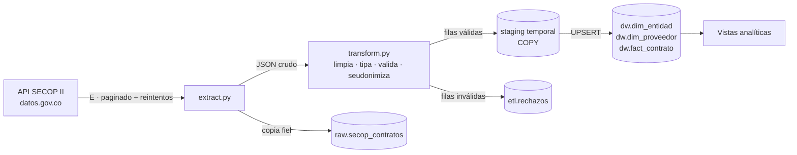

# SECOP ETL · Contratación pública del Tolima

Pipeline ETL en Python que extrae los contratos públicos de **SECOP II** (API de datos.gov.co), los limpia y valida, y los carga en un **modelo dimensional en PostgreSQL** listo para análisis. Corre con un solo comando en **Docker**.



## Resultados (corrida del 10-oct-2026, Tolima, contratos firmados en 2026)

| Métrica | Valor |
|---|---|
| Contratos cargados | 27.934 |
| Entidades / proveedores | 163 / 17.206 |
| Tiempo carga completa / incremental | ~12 s / ~3 s |
| Conciliación con la fuente | Conteo y suma de valores idénticos al centavo ($2,09 billones) |

Hallazgo de ejemplo: el **70% de los contratos** se adjudicó por contratación directa, que concentra el 27% del valor contratado (`dw.v_modalidades`).

## Cómo correrlo

```bash
cp .env.example .env
docker compose up -d db          # base de datos (crea el esquema la 1ª vez)
docker compose run --rm etl --completa   # primera carga
docker compose run --rm etl              # corridas siguientes (incremental)
```

Consultar resultados:

```bash
docker compose exec db psql -U etl -d secop -c "SELECT * FROM dw.v_modalidades;"
```

Pruebas unitarias (sin Docker):

```bash
pip install -r requirements-dev.txt
pytest
```

Para programarlo a diario en Linux, una línea de `crontab -e`:

```
0 9 * * * cd /ruta/secop-etl && docker compose run --rm etl >> etl.log 2>&1
```

## Estructura

```
etl/
  config.py     variables de entorno
  extract.py    E: API paginada con reintentos y ventana incremental
  transform.py  T: limpieza, tipos, validación, seudonimización, deduplicación
  load.py       L: staging con COPY + UPSERT a dimensiones y hechos
  main.py       orquestador y registro de ejecuciones
sql/
  01_schema.sql esquemas raw / dw / etl
  02_vistas.sql preguntas de negocio
tests/          pruebas del transform con casos sucios reales
```

## Modelo de datos

Tres esquemas, cada uno con un propósito:

- **raw**: lo que llegó de la API, sin tocar (JSONB). Permite auditar y reprocesar sin volver a llamar la API.
- **dw**: modelo estrella. `fact_contrato` (un registro por contrato, con valores y fechas) apunta a `dim_entidad` (quién contrata) y `dim_proveedor` (a quién se contrata).
- **etl**: control del pipeline. `ejecuciones` registra cada corrida (modo, filas, marca de agua, error) y `rechazos` guarda las filas que no pasaron validación con su motivo.

## Decisiones de diseño

**Idempotencia.** La carga usa `INSERT ... ON CONFLICT DO UPDATE`. Correr el pipeline dos veces con los mismos datos deja la base igual, así que si algo falla basta con volver a ejecutarlo.

**Carga incremental con ventana deslizante.** Al perfilar la fuente encontré que SECOP republica el dataset completo cada día (todas las filas tienen el mismo `:updated_at`) y que `ultima_actualizacion` viene vacío en ~69% de los contratos. No existe una forma confiable de saber qué cambió, así que cada corrida incremental reprocesa los contratos firmados en los últimos 30 días (`SECOP_VENTANA_DIAS`), y una carga `--completa` periódica recoge cambios en contratos más antiguos.

**Una transacción por lote.** Cada página de 5.000 filas entra completa o no entra. Si la ejecución falla, la marca de agua no avanza y la siguiente corrida reintenta.

**Staging + SQL por conjuntos.** Los datos limpios entran con `COPY` (mucho más rápido que `INSERT` fila por fila) a una tabla temporal, y desde ahí tres sentencias SQL pueblan las dimensiones y la tabla de hechos.

**Calidad de datos.** Problemas reales encontrados y resueltos en `transform.py`: documentos escritos como `1.005.755.668`, `cc 1007385196` o `80777291.`; valores "No Definido" usados como nulo; estados con mayúsculas inconsistentes (`cedido` / `Cedido`); y la API omitiendo campos nulos del JSON, lo que hacía desaparecer columnas completas en algunas páginas.

**Datos personales.** Solo se extraen las columnas necesarias (se excluyen cuentas bancarias y documentos de representantes legales). Las cédulas de proveedores persona natural se guardan como hash SHA-256 con sal: siguen sirviendo como llave para agrupar, pero no exponen el número. Los NIT de empresas, que son públicos, se conservan.

## Próximos pasos

- Orquestar con Apache Airflow en lugar de cron.
- Mover las transformaciones SQL a dbt, con pruebas de calidad declarativas.
- Dashboard en Metabase o Power BI sobre las vistas.

Fuente: [SECOP II – Contratos Electrónicos](https://www.datos.gov.co/Gastos-Gubernamentales/SECOP-II-Contratos-Electr-nicos/jbjy-vk9h), Colombia Compra Eficiente, licencia CC BY-SA 4.0.
